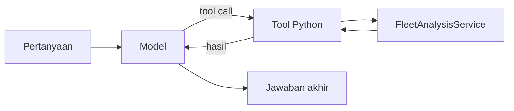

# Loop agent: siapa mengerjakan apa?

Target: mampu memisahkan keputusan model dari akses data aplikasi.

Bayangkan pertanyaan: “Cari kendaraan unit ABC, lalu jelaskan konsumsi BBM-nya.” Model bisa meminta tool pencarian, membaca hasil, lalu meminta analisis. Urutan persisnya dipilih model; ini contoh alur, bukan rekaman eksekusi.

`build_agent` merakit model, prompt, daftar tool, checkpointer, dan middleware pembatas panggilan. `create_agent` menyediakan loop model/tool; kode Kimmy menentukan kemampuan serta batasnya. Tool `search_vehicles` membungkus `FleetAnalysisService.search_vehicles` melalui helper `execute`. Model tidak diberi koneksi SQL langsung oleh tool ini.

Buka `apps/api/src/kimmy/agent/factory.py` → `build_agent`, lalu `agent/tools/search_vehicles.py` → `build_tool`. Perhatikan `ToolRuntime[AgentContext]`: aplikasi memasok konteks eksekusi, terpisah dari argumen pencarian yang diminta model.

Pembatas model/tool call dan timeout melindungi eksekusi dari loop terlalu panjang. Pembatas itu tidak membuktikan jawaban benar. Pengetahuan SOP, memory pengguna, dan hitungan fleet tetap mempunyai jalur aplikasi masing-masing.

**Latihan:** tanpa melihat kode, sebutkan siapa memilih tool dan siapa menghitung hasil fleet. Lalu periksa kembali kedua fungsi tadi.

Umpan balik
Model memilih panggilan tool; tool meneruskan pekerjaan ke service aplikasi. Jika jawabanmu “model menghitung semua data sendiri”, telusuri pemanggilan service sekali lagi.

Sumber utama: [LangChain Agents](https://docs.langchain.com/oss/python/langchain/agents). Lanjut ke [[0002-dua-stream]].

[[Home]] · [[reference/Glosarium]] · [Latihan interaktif](0001-loop-agent.html)

Tanyakan kepada agent bagian yang belum jelas. Setelah latihan, kirim jawaban dengan kata-katamu sendiri.
