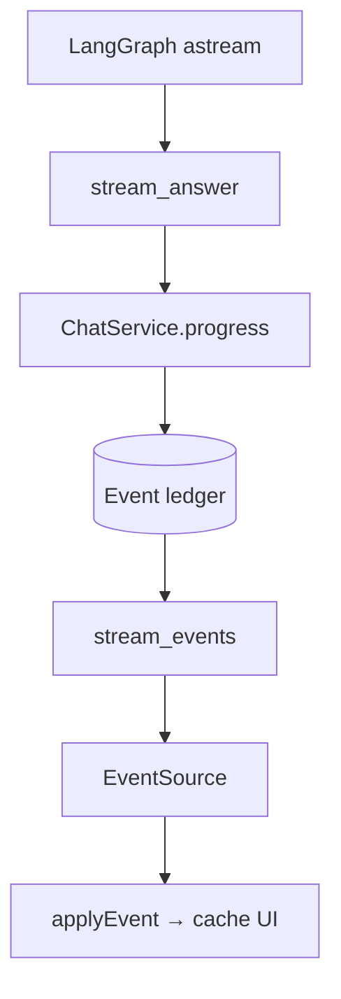

# Dua stream dan satu ledger

Target: menelusuri satu delta teks sampai tampil di browser.

Di Kimmy, stream keluaran model dan stream HTTP ke browser terhubung melalui ledger event di PostgreSQL. `stream_answer` mengonsumsi `agent.astream` dengan mode `messages` dan `updates`. Mode messages dipakai mengambil teks publik model; updates dipakai membaca perubahan pesan termasuk tool call dan hasil tool.

Pada `chat/execution.py`, teks ditampung dalam `pending`, kemudian di-flush saat panjang mencapai 256 karakter atau ketika pemrosesan chunk melihat waktu sejak flush sudah ≥ 0,15 detik. Ada flush tambahan saat ID pesan berubah dan saat stream berakhir. Ini bukan timer yang menjamin teks terkirim setiap 150 ms ketika tidak ada chunk masuk.

`progress` memeriksa memory generation dan kepemilikan run sebelum menulis event `agent.text_delta`. SSE membaca ledger; koneksinya tidak menjalankan model. `stream_events` mengeluarkan `id`, `event`, dan JSON `data`; saat tidak ada halaman lanjutan, ia menunggu 0,2 detik sebelum membaca lagi. Komentar heartbeat dikirim saat pemeriksaan interval mencapai 15 detik.

Teks sementara bukan jawaban final. `stream_answer` memvalidasi pesan akhir dan checkpoint, lalu `ChatService.complete` menyimpan jawaban dan event penyelesaian. UI menghapus teks aktivitas sementara ketika pesan assistant tersimpan datang.

**Latihan:** urutkan tanpa melihat diagram: `applyEvent`, `progress`, `astream`, `stream_events`.

Umpan balik
astream → progress → event ledger → stream_events → applyEvent. Melewatkan ledger membuat penjelasan reconnect tidak lengkap.

Sumber utama: [MDN SSE](https://developer.mozilla.org/en-US/docs/Web/API/Server-sent_events/Using_server-sent_events). Hubungkan [[0001-loop-agent]] dengan [[0003-reconnect]].

[[Home]] · [[reference/Glosarium]] · [Latihan interaktif](0002-dua-stream.html)

Tanyakan kepada agent bagian yang belum jelas. Setelah latihan, kirim jawaban dengan kata-katamu sendiri.
