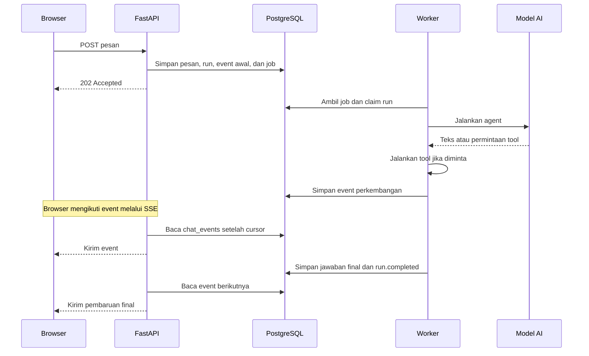

# Cara kerja chat Kimmy

> [!summary] Ide utamanya
> **API menerima pesan, worker mengerjakan jawaban, dan SSE mengirim perkembangan ke browser.** PostgreSQL menyimpan pekerjaan, hasil, dan urutan event yang menghubungkan ketiganya.

Catatan ini menjelaskan kode lokal yang ditelusuri pada sesi belajar, bukan hasil pengujian produksi. Nama file pada bagian akhir relatif terhadap root repo Kimmy.

## 1. Kenali bagian-bagiannya

| Bagian | Tanggung jawab |
|---|---|
| Browser | Mengirim pesan dan menampilkan jawaban serta aktivitas tool |
| API FastAPI | Menerima permintaan, membaca snapshot, dan melayani SSE |
| PostgreSQL | Menyimpan pesan, run, job antrean, checkpoint, dan event |
| Procrastinate | Menyediakan antrean job berbasis PostgreSQL |
| Proses worker | Mengambil job dan menjalankan agent, tool, heartbeat, serta recovery |
| Model AI | Menghasilkan teks dan memilih pemanggilan tool |

**Run** adalah satu pekerjaan menjawab input pengguna. **Thread** adalah percakapannya; satu thread dapat memiliki banyak run sepanjang waktu.

## 2. Gambaran alur lengkap



Diagram menyederhanakan proses berulang. Agent dapat memanggil beberapa tool dan model sebelum menghasilkan jawaban akhir. Koneksi SSE juga dapat sudah terbuka sebelum pesan dikirim.

## 3. Saat pengguna mengirim pesan

Endpoint `POST /api/chat/threads/{thread_id}/messages` memanggil `ChatService.admit()`.

Service memeriksa thread pengguna, pengulangan `request_key`, serta keberadaan run aktif. Kemudian, dalam **satu transaksi**, service:

1. Membuat pesan pengguna dan run berstatus `queued`.
2. Menambahkan event `message.created` dan `run.queued`.
3. Memasukkan job Procrastinate ke antrean `chat`.

`enqueue_run()` memakai koneksi database dari transaksi yang sama. Jika transaksi gagal, penulisan pesan dan job ikut di-rollback. Setelah berhasil, API mengembalikan **202 Accepted**: pekerjaan diterima, jawaban belum selesai.

> [!example] Pengiriman ulang
> Jika browser mengirim ulang permintaan dengan `request_key` dan payload yang sama, aplikasi dapat mengembalikan admission sebelumnya. Payload yang berkonflik menghasilkan `REQUEST_KEY_CONFLICT`. Pesan baru ketika masih ada run aktif dapat menghasilkan `THREAD_BUSY`.

## 4. Apa yang dijalankan worker?

Proses worker memiliki tiga pekerjaan utama:

```text
Proses worker
├── Menjalankan job chat dari antrean Procrastinate
│   └── execute_chat()
│       ├── AgentExecutor.execute(): model, tools, dan jawaban
│       └── heartbeat(): memperpanjang lease run
└── Loop recovery: memeriksa run dengan lease kedaluwarsa
```

Heartbeat dan loop recovery adalah coroutine dalam proses worker. Keduanya bukan job antrean terpisah pada implementasi ini.

### Mengklaim pekerjaan

Job bernama `kimmy.chat.execute` menjalankan `execute_chat(run_id, thread_id, user_id)`.

Sebelum menjalankan agent, task memanggil `ChatService.claim()` untuk:

1. Memastikan run masih `queued` dan belum mencapai batas percobaan.
2. Menambah jumlah percobaan.
3. Membuat `owner_token` sebagai identitas pemilik eksekusi.
4. Memberikan lease selama **30 detik**.
5. Mengubah status menjadi `running` dan mencatat event `run.running`.

Jika claim tidak berhasil, task berhenti.

### Merakit dan menjalankan agent

`AgentExecutor.execute()` membaca input run, menyiapkan model yang dipilih, lalu memanggil `build_agent()`.

```text
AgentExecutor.execute()
→ siapkan model dan checkpoint saver
→ fleet_tools(engine)
  → buat FleetAnalysisService
  → panggil build_tool(service) untuk setiap tool fleet
→ build_agent(model, saver, settings, tools, memory)
→ stream_answer(agent, ...)
```

`build_agent()` merakit prompt, model, tools, middleware, dan checkpointer. Perakitan ini menyiapkan agent; pemanggilan model dan tool terjadi ketika agent dijalankan.

**Tool dijalankan dalam proses worker yang sama.** Misalnya, `search_vehicles` memanggil service analisis fleet. Setiap pemanggilan tool tidak otomatis menjadi job Procrastinate baru.

### Mempertahankan hak eksekusi

Selama agent bekerja, heartbeat memperpanjang lease setiap **5 detik**, sehingga masa berlaku lease menjadi 30 detik dari waktu pembaruan.

Penulisan progress dan completion memeriksa token, status run, dan masa berlaku lease. Tujuannya agar worker yang kehilangan hak eksekusi tidak menerbitkan pembaruan baru. Jika heartbeat gagal, task membatalkan pekerjaan agent.

## 5. Bagaimana streaming model menjadi event?

`agent.astream()` menjalankan agent dan menyediakan keluaran secara bertahap. `stream_answer()` membacanya melalui `async for`:

```python
async for part in agent.astream(...):
    # Pilih dan olah keluaran agent.
```

Kimmy menggunakan dua mode:

| Mode | Isi keluaran | Pengolahan di Kimmy |
|---|---|---|
| `messages` | Chunk pesan model selama generasi | Mengambil teks publik dan mengumpulkannya |
| `updates` | Pembaruan state graph | Membaca pesan model, permintaan tool, dan hasil tool |

`messages` bukan khusus jawaban final. `updates` juga bukan khusus tool.

**Tidak semua chunk langsung menjadi baris database.** Teks dikumpulkan dalam buffer, kemudian di-flush ketika:

- Panjang buffer mencapai setidaknya 256 karakter.
- Saat chunk diproses, waktu sejak flush terakhir sudah mencapai 0,15 detik.
- ID pesan model berubah, atau stream berakhir.

Batas waktu tersebut diperiksa saat chunk diproses; bukan timer mandiri yang menjamin pengiriman setiap 150 ms.

Teks yang di-flush dikirim ke `ChatService.progress()` sebagai `agent.text_delta`. Pembaruan tool diolah menjadi `tool.requested` dan `tool.completed`.

## 6. Apa tugas ChatService.progress()?

Fungsi ini merupakan pintu pencatatan perkembangan agent. Dalam satu transaksi, ia:

1. Memeriksa bahwa generasi memory masih sesuai dengan konteks eksekusi.
2. Memeriksa thread milik pengguna dan mengunci row thread.
3. Memeriksa bahwa run masih dimiliki eksekutor yang sah.
4. Menambahkan event dengan nomor urut berikutnya.

Jika pemeriksaan gagal, transaksi tidak menerbitkan event tersebut. Jika berhasil, event tersimpan dan bisa dibaca koneksi SSE.

### Event ledger dan tabel chat_events

**Ledger** adalah catatan berurutan; **event** adalah satu kejadian yang dicatat. Di Kimmy, event ledger diimplementasikan oleh tabel `chat_events`.

| Kolom | Makna |
|---|---|
| `thread_id` | Percakapan pemilik event |
| `seq` | Nomor urut dalam thread |
| `run_id` | Pekerjaan terkait |
| `kind` | Jenis kejadian |
| `payload` | Data kejadian dalam JSONB |
| `created_at` | Waktu pencatatan |

Primary key-nya adalah gabungan `thread_id` dan `seq`. Nomor urut berlaku per thread, bukan satu urutan global untuk semua chat.

## 7. Bagaimana browser menerima perkembangan?

Bagian ini berjalan melalui **API**, terpisah dari eksekusi agent di worker.

```text
Worker: agent.astream → stream_answer → progress → chat_events
                                                     ↓
API:                                   stream_events membaca ledger
                                                     ↓
Browser:                               EventSource → applyEvent → UI
```

`stream_events()` membaca event setelah cursor dan mengubahnya menjadi format SSE yang berisi `id`, `event`, dan `data`. Saat tidak ada halaman lanjutan, loop menunggu 0,2 detik sebelum pembacaan berikutnya.

Browser mengambil snapshot lalu mengikuti event setelah `through_seq`. `applyEvent()` memperbarui state UI dan mengabaikan event yang nomor urutnya sudah diterapkan.

Jika koneksi terputus, hook browser mengambil snapshot baru lalu membuka kembali SSE. **Reconnect mengembalikan pengamatan UI; tidak otomatis menjalankan ulang agent.**

## 8. Kapan jawaban dianggap selesai?

Teks streaming adalah perkembangan sementara. Setelah stream berakhir, `stream_answer()` memeriksa pesan akhir, checkpoint, dan citation, lalu mengembalikan:

```python
answer, checkpoint_id, citations
```

Executor meneruskannya ke `ChatService.complete()`. Service menyimpan pesan assistant final, mengubah status run menjadi `completed`, dan menambahkan event penyelesaian dalam transaksi yang sama.

Contoh event untuk satu run sederhana:

```text
message.created       pesan pengguna
run.queued            pekerjaan masuk antrean
run.running           worker mulai menjalankan
agent.text_delta      teks sementara
agent.text_delta      tambahan teks sementara
message.created       pesan assistant final
run.completed         pekerjaan selesai
```

Run yang memakai tool juga memiliki event aktivitas tool. Jika terjadi kegagalan yang ditangani executor, `service.fail()` mencatat kegagalan run dengan kode error. Teks yang sudah terlihat tidak menjamin pekerjaan berhasil.

## 9. Bagaimana jika worker mati?

Entry point worker menjalankan loop recovery dengan jeda 5 detik. `ChatService.recover()` mencari run `running` yang lease-nya kedaluwarsa, lalu memeriksa ulang state-nya dengan lock.

- Jika jumlah percobaan masih di bawah tiga, run diantrekan ulang.
- Jika sudah mencapai tiga, run ditandai gagal dengan `WORKER_RECOVERY_EXHAUSTED`.

Task Procrastinate menggunakan `retry=False`. Recovery run kedaluwarsa diatur oleh aplikasi; ini tidak berarti setiap error agent otomatis dicoba ulang.

Worker dikonfigurasi dengan `concurrency=4`, sehingga dapat menangani hingga empat job chat secara bersamaan. Pemeriksaan run aktif tetap membatasi penerimaan pesan baru dalam satu thread.

> [!important] Bedakan tiga mekanisme
> **Reconnect** melanjutkan pengamatan browser. **Resume checkpoint** melanjutkan state graph. **Retry run** mengantrekan pekerjaan kembali. Ketiganya menangani persoalan berbeda.

## 10. Peta fungsi untuk dibaca berikutnya

| Pertanyaan | File dan fungsi |
|---|---|
| Di mana pesan diterima? | `apps/api/src/kimmy/chat/router.py` → `send_message` |
| Di mana pesan dan run dibuat? | `apps/api/src/kimmy/chat/service.py` → `admit` |
| Bagaimana job dimasukkan secara atomik? | `apps/api/src/kimmy/jobs/queue.py` → `enqueue_run` |
| Di mana proses worker dimulai? | `apps/api/src/kimmy/jobs/__main__.py` → `main` |
| Apa isi task chat? | `apps/api/src/kimmy/jobs/tasks.py` → `execute_chat` di dalam `register_tasks` |
| Di mana agent dirakit? | `apps/api/src/kimmy/chat/execution.py` → `AgentExecutor.execute` |
| Di mana keluaran agent diolah? | `apps/api/src/kimmy/chat/execution.py` → `stream_answer` |
| Di mana event ditulis? | `apps/api/src/kimmy/chat/service.py` → `progress`, lalu repository → `append_event` |
| Di mana event dibaca untuk SSE? | `apps/api/src/kimmy/chat/stream.py` → `stream_events` |
| Di mana UI mengikuti stream? | `apps/web/src/features/chat/hooks/use-chat-stream.ts` → `useChatStream` |
| Di mana UI menerapkan event? | `apps/web/src/features/chat/events.ts` → `applyEvent` |

## Latihan singkat

Jawab sebelum membuka penjelasan:

1. Jika browser ditutup ketika agent bekerja, bagian mana yang masih bisa melanjutkan pekerjaan?
2. Apakah `search_vehicles` dijalankan oleh koneksi SSE?
3. Mengapa pesan dan job disimpan dalam satu transaksi?

> [!question]- Periksa jawabanmu
> 1. Worker dapat terus menjalankan agent dan menyimpan event selama prosesnya tetap sehat.
> 2. Tidak. Tool dijalankan dalam proses worker; SSE membaca event tersimpan melalui API.
> 3. Agar penerimaan pesan dan penjadwalan pekerjaan mengikuti commit/rollback bersama.

Tanyakan kepada agent bagian yang belum jelas. Untuk pendalaman, baca [[lessons/0002-dua-stream|Dua stream dan ledger]], [[lessons/0004-run-checkpoint|Run dan checkpoint]], serta [[RESOURCES|sumber resmi framework]].

[[Home]] · [[reference/Glosarium|Glosarium]] · [[reference/Peta Kode|Peta kode]]
